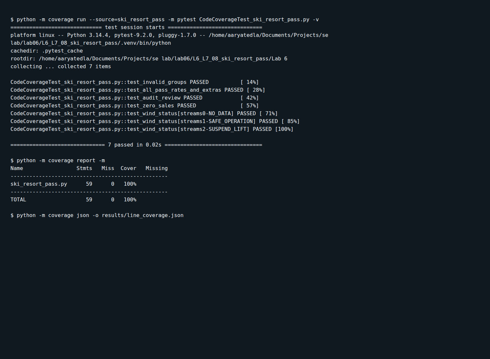
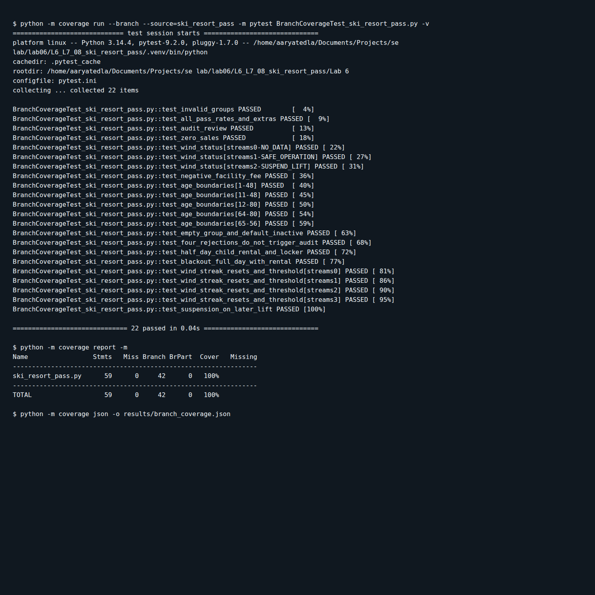

# Lab 6: Code and Branch Coverage Analysis

Name: Aarya Tedla

SRN: PES1UG24CS496

Section: I

Application: Ski Resort Pass

Repository: https://github.com/AaryaTedla/L6_L7_08_ski_resort_pass

The application calculates ski pass prices and checks chairlift wind readings. Tests cover pass durations, age boundaries, rentals, lockers, blackout overrides, invalid inputs, audit status, and wind gust streaks.

## Test files

- [CodeCoverageTest_ski_resort_pass.py](CodeCoverageTest_ski_resort_pass.py): line coverage tests (7 tests).
- [BranchCoverageTest_ski_resort_pass.py](BranchCoverageTest_ski_resort_pass.py): branch coverage and boundary tests (22 tests).
- [test_ski_resort.py](test_ski_resort.py): starter test (1 test).

All 30 tests pass. Both coverage suites independently achieve 100% line coverage; the branch suite also covers all 42 branches.

## Line coverage

Run from the `Lab 6` folder with the virtual environment activated:

```bash
python -m coverage run --source=ski_resort_pass -m pytest CodeCoverageTest_ski_resort_pass.py -v
python -m coverage report -m
```

Result: **100% line coverage**, 59 of 59 statements covered.



## Branch coverage

```bash
python -m coverage run --branch --source=ski_resort_pass -m pytest BranchCoverageTest_ski_resort_pass.py -v
python -m coverage report -m
```

Result: **100% branch coverage**, 42 of 42 branches covered, with no missing statements or partial branches.



To run all tests:

```bash
python -m pytest -q
```
