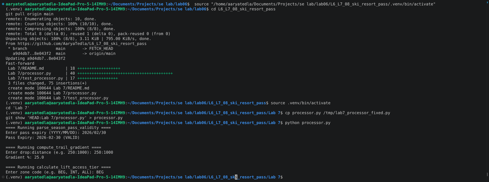
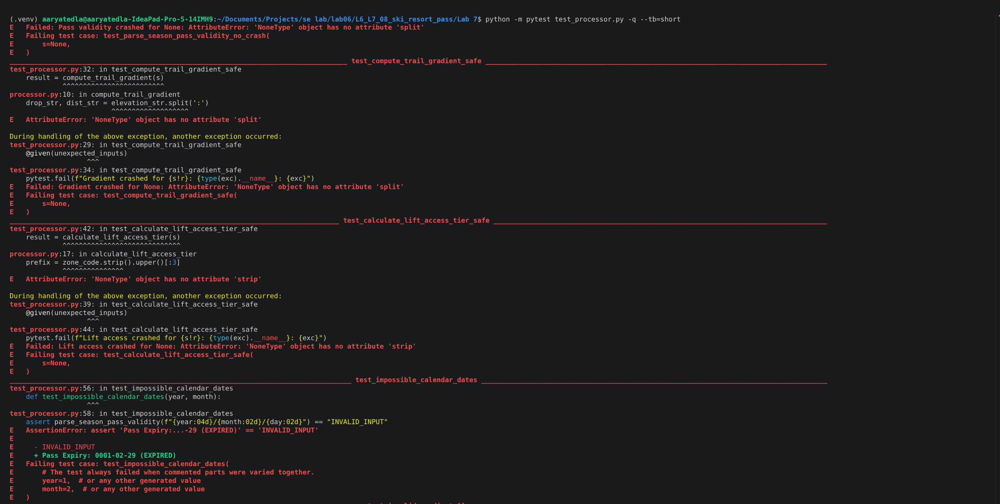
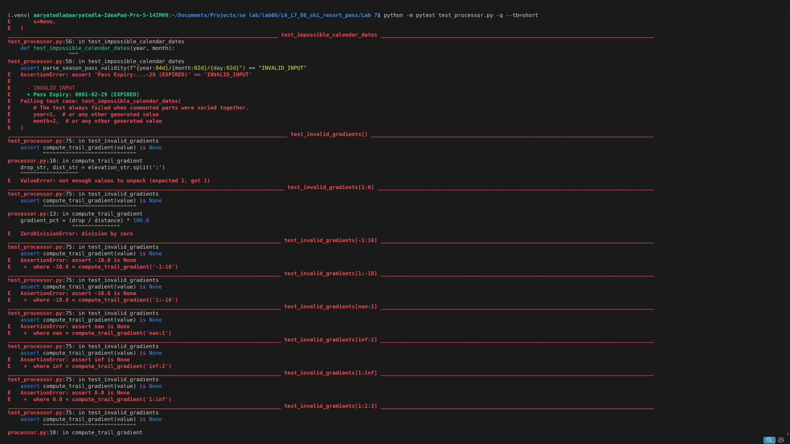
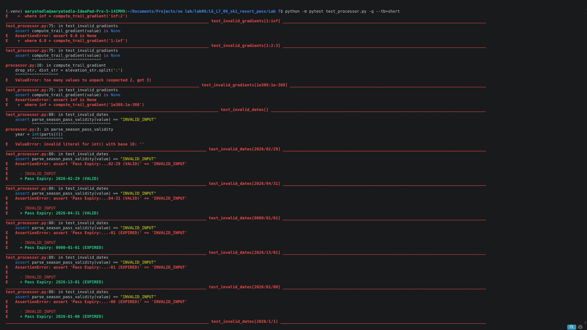
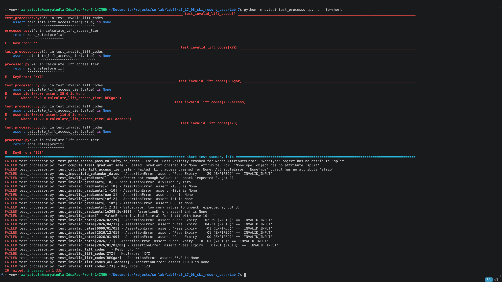
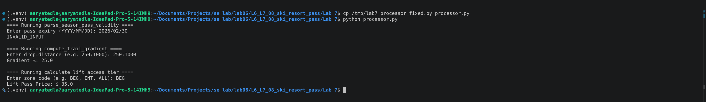
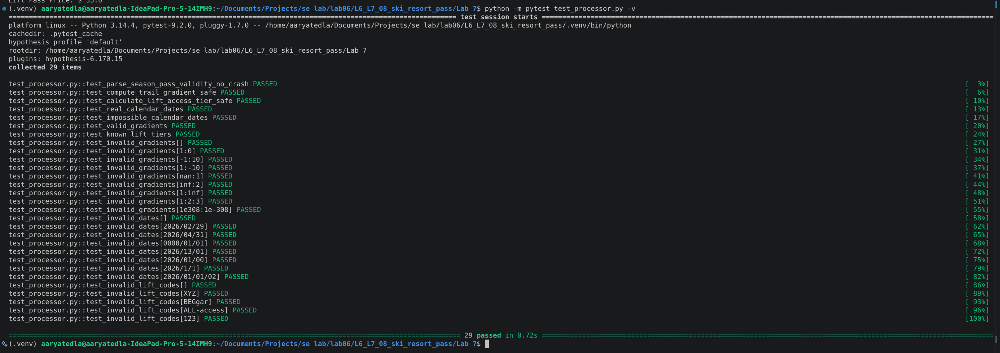

# Lab 7: Fuzz Testing for Input Validation Bugs

Name: Aarya Tedla

SRN: PES1UG24CS496

Section: I

Application: Ski Resort Pass

Repository: https://github.com/AaryaTedla/L6_L7_08_ski_resort_pass

## Run

Activate the repository's `.venv`, install `hypothesis` and `pytest`, and run from `Lab 7`:

```bash
python processor.py
python -m pytest test_processor.py -v
```

## Bugs and fixes

- Pass validity: malformed values crashed and impossible dates were accepted. The fixed function validates `YYYY/MM/DD` and the actual calendar date. Invalid inputs return `INVALID_INPUT`. The original year >= 2026 validity rule is preserved.
- Trail gradient: malformed values and zero distance crashed; negative and non-finite measurements produced invalid results. Invalid inputs now return `None`; valid values require a non-negative drop, positive distance, and finite result.
- Lift access: unknown codes crashed, and arbitrary text beginning with a recognised prefix was accepted. The fixed function accepts exact BEG, INT, ADV, and ALL codes, ignoring case and surrounding whitespace. Invalid inputs return `None`.

The command-line application displays `INVALID_INPUT` for rejected input and continues to the next prompt.

## Before fixing

The application was run with `2026/02/30`, `250:1000`, and `BEG`. It incorrectly marked February 30 as valid.



The three starter no-crash properties were completed using Hypothesis and try/except. Each unexpected exception causes a test failure. The complete suite was run against the original application:

```bash
python -m pytest test_processor.py -q --tb=short
```

Result: **26 failed, 3 passed**. Hypothesis exposed crashes with `None` and invalid calendar dates. Regression tests also exposed zero division, negative and non-finite gradients, malformed dates, and unknown or misleading zone codes.









## After fixing

The same application inputs now reject the impossible date while retaining the correct gradient and price.



The complete test suite passes: **29 tests**. Generated inputs include strings, None, integers, floats, booleans, lists, and dictionaries. Further properties check real dates, impossible dates, valid gradients, and recognised codes. Regression cases cover malformed dates, zero distance, negatives, NaN, infinity, overflow, and unknown codes.



All screenshots above are original terminal captures taken by the student.
